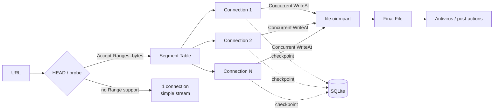

<div align="center">


# OpenIDM — Download Manager

**Fast, resumable, and organized downloads — 100% open source, built from scratch in Go.**

🌐 **[🇧🇷 Leia em Português (Brasil)](README.md)** | **🇺🇸 English (United States)**

[](LICENSE)


[Features](#-features) •
[Screenshots](#-screenshots) •
[Installation](#-installation) •
[How Speed Works](#-how-speed-works) •
[Building](#-building-from-source) •
[Documentation](#-documentation) •
[Contributing](#-contributing)

</div>

---

## 📖 About the Project

**OpenIDM** is a modern multi-segment download manager for Windows with full **English (`en-US`)** and **Brazilian Portuguese (`pt-BR`)** support, built **from scratch** and inspired by the acceleration architecture of the classic *Internet Download Manager*. Its goal is simple: deliver what makes a download manager genuinely fast and reliable — **dynamic work-stealing segmentation, keep-alive connection reuse, and crash-proof resume** — in a **free, open-source, auditable desktop application**.

Not a single line of third-party proprietary code or binary is reused: the download engine, desktop UI, browser extension, and installer are a **clean-room, independent implementation** written in **Go + Wails v2 + React**.

> [!NOTE]
> OpenIDM is an independent open-source project and is **not affiliated with** Tonec Inc. or *Internet Download Manager*. "IDM" and "Internet Download Manager" are trademarks of their respective owners and are mentioned strictly as a conceptual reference.

### Why OpenIDM?

| | |
|---|---|
| ⚡ **Genuinely Fast** | Splits files into up to **32 concurrent connections** that dynamically split the largest active segment so no worker ever sits idle. |
| 🛡️ **Never Lose Progress** | Continuous SQLite checkpoints — close the app, reboot your PC, or lose power and resume from the exact byte. |
| 🌐 **Browser Integration** | Manifest V3 extension for **Chrome, Edge, Brave, and Firefox** that automatically captures downloads. |
| 🗂️ **Organized** | Automatic file categorization by extension, custom queues, scheduler, and ETag sync queue. |
| 🪶 **Lightweight & Native** | Native Windows desktop app powered by WebView2, system tray integration, and a compact **Standalone Card** mode. |
| 🌍 **Bilingual Interface** | Instant switching between **English (EN-US)** and **Portuguese (PT-BR)** across the app, tray, installer, and browser extension. |
| 🔓 **Free & Open Source** | MIT License. Use, study, modify, and redistribute freely. |

---

## ✨ Features

### 🚀 Download Engine
- **Adaptive Dynamic Segmentation** — starts with 1 segment and, whenever a connection becomes free, splits the **largest in-flight segment** in half (respecting a configurable minimum split size, default 1 MB).
- **Keep-Alive Connection Reuse** — TCP/TLS connections that finish a segment are immediately reused for the next slice **without a new TLS handshake or authentication round-trip**.
- **Up to 32 Connections per Download** (default 8), configurable globally and per site.
- **Crash-Safe Resume** — partial `.oidmpart` file with concurrent `WriteAt` I/O and segment map checkpoints persisted in SQLite.
- **Graceful Degradation** — if a server does not support `Range` / `HTTP 206` or returns inconsistent ranges, automatically falls back to a single connection with a clear diagnostic notice.
- **Multi-Protocol** — HTTP, HTTPS, and **FTP (PASV mode)**.
- **Proxy Support** — HTTP, HTTPS, **SOCKS5**, system proxy settings, and **PAC** auto-config scripts.
- **Speed Limiter** — token-bucket bandwidth throttling globally and per download.
- **Server Credentials** — HTTP Basic, Bearer Token, or FTP credentials automatically applied by host pattern.
- **Automatic Retry** with configurable interval (default 30 s) and automatic recovery of stalled connections.

### 🌐 Download Capture
- **Manifest V3 WebExtension** for Chrome, Edge, Brave, and Firefox with automatic file-type interception.
- **Context Menu** — "Download with OpenIDM" on any link or media element.
- **Bypass Modifier Key** — hold **`ALT`** while clicking a link to let the browser download normally.
- **Native Messaging Host** (`openidm-native-host.exe`) with automatic Windows Registry configuration.
- **Clipboard Monitor** — copy a download URL and OpenIDM offers to capture it automatically.
- **Per-Site Rules with Wildcards** (`*.example.com`) to ignore capture or cap maximum connections per host.
- **Command Line** — `openidm.exe <url>` opens the capture prompt directly in the Compact Card.

### 🗂️ Organization & Scheduler
- **Automatic Categories** by file extension, each with its own default folder: Compressed, Documents, Music, Programs, Video, and General.
- **Queues** — Main Queue, custom queues, and **Sync Queue** (periodically checks `ETag` / `Last-Modified` headers and re-downloads updated files).
- **Scheduler** — scheduled start and stop times, concurrent downloads per queue, **traffic quota (MB)**, and max retry count.
- **Post-Queue Actions** — run a custom command/script or **shut down the computer** upon completion (with an abort button).
- **Antivirus Scan on Completion** — invokes any external scanner, replacing `[file]` with the downloaded file path.

### 🖥️ Desktop Interface & Multi-Language Support
- Modern dark UI with instant **English (`en-US`)** and **Brazilian Portuguese (`pt-BR`)** switching (via the `🌐 EN / PT` button on the toolbar or in **Options**).
- **Download Table** with file size, progress bar, transfer speed, remaining time, category, and date added.
- **Real-Time Segment Bar** and connection telemetry in the download details dialog.
- **Compact Card (Standalone Card)** — a compact floating window to confirm new downloads and track active transfers without cluttering your screen.
- **System Tray** — runs quietly in the background with a localized context menu and native balloon notifications.
- **Single-Instance Lock** — opening new links hands them off cleanly to the running instance.
- **Built-in Self-Updater (GitHub Releases)** — **🔄 Update** button on the toolbar plus automatic background checks, letting you **Update Now** (downloads and installs automatically) or **Postpone for 24h**.
- **Built-in Graphical Installer** with desktop/Start Menu shortcuts, Windows startup registration, uninstaller, and browser extension setup wizard.

---

## 📸 Screenshots

<div align="center">

### Main Window
Categories, status filters, and queues in the sidebar; downloads with progress, speed, and ETA.


<br/><br/>

### Compact Card (Standalone Card)
Compact mode to monitor downloads without taking over your screen — pause, stop, open file or folder, and switch to the full app anytime.


</div>

---

## 📥 Installation

### Option 1 — Official Installer (Recommended)

1. Download **`OpenIDM-Setup-1.0.1-x64.exe`** from the [Releases](../../releases) page or the [`release/v1.0.1`](release/v1.0.1) folder in this repository.
2. *(Optional)* Verify the file checksum against [`SHA256SUMS.txt`](release/v1.0.1/SHA256SUMS.txt):

   ```powershell
   Get-FileHash .\OpenIDM-Setup-1.0.1-x64.exe -Algorithm SHA256
   ```

3. Run the installer — it is a single self-contained executable bundling the desktop app, Native Host, and browser extension — and select your preferences (available in both **English** and **Portuguese**):
   - Installation directory (default: `%LOCALAPPDATA%\Programs\OpenIDM` — no administrator privileges required);
   - Launch automatically with Windows (minimized to system tray);
   - Desktop and Start Menu shortcuts;
   - Uninstaller registration in *Installed Apps*;
   - Browser integration (Native Messaging + extension).
4. At the end of installation, follow the interactive extension activation guide (see [Browser Extension Guide](docs/BROWSER-EXTENSION.md)).

> [!TIP]
> Because the binary is not yet signed with an EV code-signing certificate, Windows SmartScreen may show a warning. Click **More info → Run anyway**, or build it yourself from source in one command.

### Option 2 — Command Line

```powershell
# Silent full installation (shortcuts, auto-start, browser integration)
openidm.exe --install

# Install to a custom folder
openidm.exe --install --install-dir "D:\Apps\OpenIDM"

# Uninstall
openidm.exe --uninstall
```

| Flag | Description |
|---|---|
| `<url>` | Opens the URL capture prompt directly in the Compact Card |
| `--tray` | Starts hidden in the Windows system tray |
| `--installer` | Opens the built-in system installer and extension wizard |
| `--install` | Performs a silent full installation |
| `--install-dir <dir>` | Custom installation folder |
| `--launch-ext` | Launches the browser extension activation guide during `--install` |
| `--uninstall` | Removes auto-start, shortcuts, and Native Host registration |
| `--db <file>` | Uses a custom SQLite database file |

Application data (downloads, queues, settings, language preference) is stored in `%APPDATA%\OpenIDM\openidm.sqlite`.

---

## ⚡ How Speed Works

Download acceleration does **not** come from a single "magic socket", but from combining three techniques:



1. **Adaptive Work-Stealing Parallelism** — when a worker finishes its byte range, it never sits idle: the engine finds the **largest remaining segment** and splits it in half, handing the second half to the free connection. Every connection stays busy until the last byte.
2. **Zero Renegotiation Overhead** — the existing keep-alive TCP/TLS connection is reused for the newly split segment, avoiding TLS handshake and login latency.
3. **Per-Connection Throttling Bypass** — servers that cap bandwidth per TCP stream are naturally accelerated across *N* parallel streams.

```text
Start          [██████████████████████████████████████████████]  1 segment
Free worker    [███████████████████████|███████████████████████]  splits largest in half
More workers   [███████████|███████████|███████████|███████████]  all connections busy
Completed      [▓▓▓▓▓▓▓▓▓▓▓▓▓▓▓▓▓▓▓▓▓▓▓▓▓▓▓▓▓▓▓▓▓▓▓▓▓▓▓▓▓▓▓▓▓▓]  assembled
```

See [docs/ARCHITECTURE.md](docs/ARCHITECTURE.md) for full technical details.

---

## 🔧 Building from Source

### Prerequisites

| Tool | Version |
|---|---|
| [Go](https://go.dev/dl/) | 1.25 or newer |
| [Node.js](https://nodejs.org/) | 18 or newer (with npm) |
| [WebView2 Runtime](https://developer.microsoft.com/microsoft-edge/webview2/) | Pre-installed on Windows 10/11 |
| [Wails CLI](https://wails.io/docs/gettingstarted/installation) | v2.x *(optional — only needed for `wails dev`)* |

### Full Release Build (Single Command)

```powershell
./scripts/build.ps1
```

The script compiles the React frontend, generates Windows resources/icons, runs `go vet` and all unit tests, compiles the binaries in `build/bin/`, and packages the standalone installer in `release/v<version>/` alongside `SHA256SUMS.txt`.

| Output | Description |
|---|---|
| `build/bin/openidm.exe` | Main desktop application |
| `build/bin/openidm-native-host.exe` | Browser Native Messaging Host |
| `build/bin/OpenIDM-Setup.exe` | Self-contained graphical installer |
| `release/v1.0.1/OpenIDM-Setup-1.0.1-x64.exe` | Versioned release installer |

### Development & Testing

```powershell
# Hot-reload development mode (requires Wails CLI)
wails dev

# Run all unit and integration tests
go test ./...
```

Full build instructions: [docs/BUILDING.md](docs/BUILDING.md).

---

## 📚 Documentation

| Document (English) | Documento (Português) | Topic |
|---|---|---|
| [User Guide](docs/USER-GUIDE.md) | [Guia de uso](docs/GUIA-DE-USO.md) | Interface tour, adding downloads, Compact Card, queues, scheduler, options, and language switching |
| [Browser Extension](docs/BROWSER-EXTENSION.md) | [Extensão do navegador](docs/EXTENSAO-NAVEGADOR.md) | Installing and using the Chrome, Edge, and Firefox extension |
| [Architecture](docs/ARCHITECTURE.md) | [Arquitetura](docs/ARQUITETURA.md) | Dynamic segmentation engine, SQLite persistence, system integration, and design decisions |
| [Building & Development](docs/BUILDING.md) | [Compilação](docs/COMPILACAO.md) | Dev setup, build pipeline, test suite, and release packaging |
| [Changelog](CHANGELOG.md) | [Changelog](CHANGELOG.md) | Version history (bilingual) |
| [Security Policy](SECURITY.md) | [Segurança](SECURITY.md) | Reporting vulnerabilities |

---

## 🗺️ Roadmap

- [x] **Phase 0** — Foundation: desktop app, SQLite store, and base UI
- [x] **Phase 1** — Engine: dynamic segmentation, connection reuse, crash-safe resume, FTP, and proxy support
- [x] **Phase 2** — Capture: Manifest V3 extension, Native Messaging, clipboard monitor, and per-site rules
- [x] **Phase 3** — Organization: categories, queues, scheduler, ETag synchronization, and antivirus integration
- [x] **Internationalization** — Full English (`en-US`) and Brazilian Portuguese (`pt-BR`) support across app, tray, installer, extension, and docs
- [x] **In-App Automatic Updater** — GitHub Releases checker with one-click self-update and 24-hour snooze option (v1.0.1)
- [ ] **Phase 4** — *Site Grabber*: full website spider with depth and file-type filters
- [ ] **Phase 5** — Video/Streaming: media stream detection, HLS/DASH, and ffmpeg muxing
- [ ] EV Code Signing certificate
- [ ] Linux and macOS support

---

## 🤝 Contributing

Contributions are very welcome! Bug reports, feature suggestions, translations, documentation improvements, and pull requests.

1. Fork the repository
2. Create a feature branch: `git checkout -b feature/my-improvement`
3. Run the test suite: `go test ./...`
4. Commit your changes: `git commit -m "feat: my improvement"`
5. Open a Pull Request

Please read the [Contributing Guide](CONTRIBUTING.md) before getting started.

---

## ⚖️ Legal Notice

OpenIDM is a **clean-room, independent implementation**: it does not contain, distribute, or depend on any code, binaries, or assets from *Internet Download Manager*. Please use this software responsibly and respect the terms of service of the websites and servers you download from.

## 📄 License

Distributed under the **MIT License**. See [LICENSE](LICENSE) for details.

---

<div align="center">

Built with ☕ and Go by **RafaTech**

If OpenIDM is useful to you, please consider giving the repository a ⭐!

</div>
