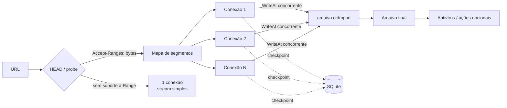

<div align="center">


# OpenIDM — Gerenciador de Downloads

**Downloads rápidos, retomáveis e organizados — 100% open source, feito do zero em Go.**

🌐 **🇧🇷 Português (Brasil)** | **[🇺🇸 Read in English](README.en.md)**

[](LICENSE)


[Recursos](#-recursos) •
[Capturas de tela](#-capturas-de-tela) •
[Instalação](#-instalação) •
[Como funciona](#-como-a-velocidade-funciona) •
[Compilar](#-compilando-a-partir-do-código-fonte) •
[Documentação](#-documentação) •
[Contribuir](#-contribuindo)

</div>

---

## 📖 Sobre o projeto

O **OpenIDM** é um gerenciador de downloads moderno para Windows, com suporte nativo a **Português (PT-BR)** e **Inglês (EN-US)**, criado **do zero** com inspiração no conceito de aceleração do clássico *Internet Download Manager*. A ideia é simples: trazer o que torna um gerenciador de downloads realmente rápido e confiável — **segmentação dinâmica, reuso de conexões e retomada à prova de quedas** — num aplicativo **livre, de código aberto e auditável**.

Nenhuma linha de código ou binário de terceiros foi reaproveitada: o motor de download, a interface, a extensão do navegador e o instalador são uma **reimplementação limpa e independente**, escrita em **Go + Wails v2 + React**.

> [!NOTE]
> O OpenIDM é um projeto independente e **não tem qualquer vínculo** com a Tonec Inc. ou com o produto *Internet Download Manager*. "IDM" e "Internet Download Manager" são marcas de seus respectivos proprietários e são citadas aqui apenas como referência de inspiração.

### Por que o OpenIDM?

| | |
|---|---|
| ⚡ **Rápido de verdade** | Divide o arquivo em até **32 conexões** que se redistribuem sozinhas, sempre mantendo todas ocupadas. |
| 🛡️ **Nunca perde progresso** | Checkpoints contínuos no SQLite — feche o app, reinicie o PC ou perca a energia e continue de onde parou. |
| 🌐 **Integrado ao navegador** | Extensão para **Chrome, Edge e Firefox** que captura os downloads automaticamente. |
| 🗂️ **Organizado** | Categorias automáticas por extensão, filas, agendador e fila de sincronização. |
| 🪶 **Leve e nativo** | App desktop nativo com WebView2, ícone na bandeja e um modo **Card Solto** compacto. |
| 🌍 **Bilíngue (PT-BR / EN-US)** | Alternância instantânea entre **Português** e **Inglês** no aplicativo, bandeja, instalador e extensão. |
| 🔓 **Livre** | Licença MIT. Use, estude, modifique e redistribua. |

---

## ✨ Recursos

### 🚀 Motor de download
- **Segmentação dinâmica adaptativa** — começa com 1 segmento e, sempre que uma conexão fica livre, divide ao meio o **maior segmento em andamento** (respeitando um tamanho mínimo configurável, padrão 1 MB).
- **Reuso de conexões keep-alive** — conexões TCP/TLS que terminam um segmento são reaproveitadas para o próximo, **sem novo handshake TLS ou login**.
- **Até 32 conexões por download** (padrão 8), configurável globalmente e por site.
- **Retomada robusta** — arquivo parcial `.oidmpart` com escrita concorrente (`WriteAt`) e mapa de segmentos salvo no SQLite em intervalos curtos.
- **Degradação segura** — se o servidor não suportar `Range`/`HTTP 206` ou apresentar inconsistência, cai automaticamente para 1 conexão, com aviso.
- **Multiprotocolo** — HTTP, HTTPS e **FTP (modo PASV)**.
- **Proxy** — HTTP, HTTPS, **SOCKS5**, proxy do sistema e arquivos **PAC**.
- **Limitador de velocidade** (token bucket) global e por download.
- **Credenciais por servidor** — HTTP Basic, Bearer Token ou FTP, aplicadas automaticamente por padrão de host.
- **Retry automático** com intervalo configurável (padrão de 30 s) e reconexão de conexões quebradas.

### 🌐 Captura de downloads
- **Extensão WebExtension Manifest V3** para Chrome, Edge e Firefox, com interceptação automática por tipo de arquivo.
- **Menu de contexto** "Baixar com o OpenIDM" em qualquer link.
- **Tecla modificadora** — segure **`ALT`** ao clicar para deixar o navegador baixar normalmente.
- **Native Messaging Host** (`openidm-native-host.exe`) com registro automático no Registro do Windows.
- **Monitor da área de transferência** — copiou uma URL de download? O OpenIDM oferece baixar.
- **Exceções por site com curingas** (`*.exemplo.com`) para ignorar captura ou limitar conexões.
- **Linha de comando** — `openidm.exe <url>` abre a captura direto no Card Solto.

### 🗂️ Organização e agendamento
- **Categorias automáticas** por extensão, cada uma com sua pasta: Comprimidos, Documentos, Música, Programas, Vídeo e Geral.
- **Filas** — Fila Principal, filas customizadas e **Fila de Sincronização** (verifica `ETag`/`Last-Modified` e baixa de novo se o arquivo mudou no servidor).
- **Agendador** — horário de início e de parada, downloads simultâneos por fila, **cota de tráfego (MB)**, número máximo de tentativas.
- **Ações ao concluir** — executar um comando/programa ou **desligar o computador** (com opção de cancelar).
- **Antivírus ao concluir** — chama qualquer scanner externo, substituindo `[file]` pelo caminho do arquivo baixado.

### 🖥️ Interface e Idiomas
- Interface escura e moderna com suporte completo a **Português (PT-BR)** e **Inglês (EN-US)** (troca rápida pelo botão `🌐 PT / EN` na barra de ferramentas ou em **Opções**).
- **Lista de downloads** com tamanho, progresso, velocidade, tempo restante, categoria e data.
- **Barra de segmentos** e log de conexões em tempo real na tela de detalhes.
- **Card Solto** — uma janela compacta, sempre à mão, para acompanhar e controlar os downloads ativos.
- **Bandeja do sistema** — roda em segundo plano, com menu rápido e notificações nativas traduzidas.
- **Instância única** — novos links abertos pelo sistema são entregues à janela já aberta.
- **Atualizador integrado (GitHub Releases)** — botão **🔄 Atualizar** na barra de ferramentas e verificação automática em segundo plano, com opção de **Atualizar Agora** (download e instalação automática) ou **Adiar por 24h**.
- **Instalador gráfico** próprio bilíngue com atalhos, inicialização com o Windows, desinstalador e ativação da extensão.

---

## 📸 Capturas de tela

<div align="center">

### Janela principal
Categorias, status e filas na lateral; downloads com progresso, velocidade e tempo restante.


<br/><br/>

### Card Solto
Modo compacto para acompanhar os downloads sem ocupar a tela — pausar, parar, abrir o arquivo ou a pasta e ajustar as conexões ali mesmo.


</div>

---

## 📥 Instalação

### Opção 1 — Instalador (recomendado)

1. Baixe o **`OpenIDM-Setup-1.0.1-x64.exe`** na página de [Releases](../../releases) ou na pasta [`release/v1.0.1`](release/v1.0.1) deste repositório.
2. *(Opcional)* Confira a integridade do arquivo com o [`SHA256SUMS.txt`](release/v1.0.1/SHA256SUMS.txt):

   ```powershell
   Get-FileHash .\OpenIDM-Setup-1.0.1-x64.exe -Algorithm SHA256
   ```

3. Execute o instalador — ele é um único arquivo, com o aplicativo, o Native Host e a extensão embutidos — e escolha as opções desejadas (disponível em **Português** e **Inglês**):
   - Pasta de instalação (padrão: `%LOCALAPPDATA%\Programs\OpenIDM` — não exige administrador);
   - Iniciar com o Windows (na bandeja);
   - Atalhos na Área de Trabalho e no Menu Iniciar;
   - Registro do desinstalador em *Aplicativos instalados*;
   - Integração com o navegador (Native Messaging + extensão).
4. Ao final, siga o assistente de ativação da extensão (ver [Extensão do navegador](docs/EXTENSAO-NAVEGADOR.md)).

> [!TIP]
> Como o executável ainda não é assinado digitalmente, o Windows SmartScreen pode exibir um aviso. Clique em **Mais informações → Executar assim mesmo**. Se preferir, compile você mesmo a partir do código-fonte.

### Opção 2 — Linha de comando

```powershell
# Instalação silenciosa completa (atalhos, auto-start, extensão)
openidm.exe --install

# Instalação em pasta personalizada
openidm.exe --install --install-dir "D:\Apps\OpenIDM"

# Desinstalar
openidm.exe --uninstall
```

| Parâmetro | Descrição |
|---|---|
| `<url>` | Abre a captura da URL diretamente no Card Solto |
| `--tray` | Inicia oculto na bandeja do sistema |
| `--installer` | Abre o assistente de instalação e extensão |
| `--install` | Instalação silenciosa completa |
| `--install-dir <pasta>` | Pasta de instalação customizada |
| `--launch-ext` | Abre o navegador para ativar a extensão durante `--install` |
| `--uninstall` | Remove auto-start, atalhos e Native Host |
| `--db <arquivo>` | Usa um banco SQLite customizado |

Os dados do aplicativo (downloads, filas, configurações, idioma) ficam em `%APPDATA%\OpenIDM\openidm.sqlite`.

---

## ⚡ Como a velocidade funciona

O ganho de velocidade **não** vem de "uma conexão gigante", mas da combinação de três técnicas:



1. **Paralelismo adaptativo** — quando uma conexão termina seu trecho, ela não fica parada: o motor pega o **maior segmento pendente** e o divide ao meio, entregando a metade para a conexão livre. Todas as conexões trabalham até o último byte.
2. **Zero renegociação** — a mesma conexão TCP/TLS é reaproveitada para o próximo trecho, eliminando o custo de handshake e login.
3. **Servidores que limitam por conexão** são superados naturalmente com N conexões simultâneas.

```text
Início         [██████████████████████████████████████████████]  1 segmento
Conexão livre  [███████████████████████|███████████████████████]  divide o maior ao meio
Mais conexões  [███████████|███████████|███████████|███████████]  todas ocupadas
Final          [▓▓▓▓▓▓▓▓▓▓▓▓▓▓▓▓▓▓▓▓▓▓▓▓▓▓▓▓▓▓▓▓▓▓▓▓▓▓▓▓▓▓▓▓▓▓]  concluído
```

Detalhes completos em [docs/ARQUITETURA.md](docs/ARQUITETURA.md) ([English](docs/ARCHITECTURE.md)).

---

## 🔧 Compilando a partir do código-fonte

### Pré-requisitos

| Ferramenta | Versão |
|---|---|
| [Go](https://go.dev/dl/) | 1.25 ou superior |
| [Node.js](https://nodejs.org/) | 18 ou superior (com npm) |
| [WebView2 Runtime](https://developer.microsoft.com/microsoft-edge/webview2/) | já incluso no Windows 10/11 |
| [Wails CLI](https://wails.io/docs/gettingstarted/installation) | v2.x *(opcional — apenas para `wails dev`)* |

### Build completo (um comando)

```powershell
./scripts/build.ps1
```

O script compila o frontend, gera o ícone e a versão do Windows, roda os testes, compila os executáveis em `build/bin/` e gera o instalador final em `release/v<versão>/`, junto com o `SHA256SUMS.txt`.

| Saída | Conteúdo |
|---|---|
| `build/bin/openidm.exe` | Aplicativo desktop |
| `build/bin/openidm-native-host.exe` | Native Messaging Host |
| `build/bin/OpenIDM-Setup.exe` | Instalador com tudo embutido |
| `release/v1.0.1/OpenIDM-Setup-1.0.1-x64.exe` | Instalador versionado para publicação |

### Desenvolvimento

```powershell
# Interface com hot reload (requer Wails CLI)
wails dev

# Testes
go test ./...
```

A suíte cobre o motor de segmentação, o agendador, o armazenamento SQLite (incluindo migrações), a integração com o navegador, o suporte a múltiplos idiomas, o empacotamento do instalador e a camada de processos do sistema.

Guia completo: [docs/COMPILACAO.md](docs/COMPILACAO.md) ([English](docs/BUILDING.md)).

---

## 🧱 Stack e estrutura do projeto

| Camada | Tecnologia |
|---|---|
| Motor de download | **Go** — goroutines, `net/http` com `Transport` customizado, `httptrace` |
| App desktop | **Wails v2** (WebView2) |
| Interface | **React 18 + TypeScript + Vite** (i18n PT-BR & EN-US) |
| Persistência | **SQLite** via `modernc.org/sqlite` (Go puro, sem CGO) |
| FTP | `github.com/jlaffaye/ftp` |
| Proxy SOCKS5 | `golang.org/x/net/proxy` |
| Navegador | **WebExtension MV3** + Native Messaging |
| Bandeja / clipboard | Win32 API direta (sem dependências externas) |

```text
OpenIDM-Download-Manager/
├── .github/                 # CI, modelos de issue e pull request
├── browser-extension/       # Extensão MV3 (Chrome / Edge / Firefox)
├── build/
│   ├── appicon.png          # Ícone do aplicativo
│   └── windows/             # icon.ico e winres.json (ícone, manifesto e versão do .exe)
├── cmd/
│   ├── installer/           # Instalador gráfico (OpenIDM-Setup.exe)
│   └── native-host/         # openidm-native-host.exe
├── docs/                    # Documentação (PT-BR e EN-US) e imagens
├── frontend/                # Interface React + TypeScript + Vite + i18n
├── internal/
│   ├── engine/              # Motor: segmentação, workers HTTP/FTP, transporte, limitador
│   ├── integration/         # Ponte HTTP local, Native Messaging, clipboard, bandeja, instalação
│   ├── models/              # Tipos de domínio compartilhados
│   ├── scheduler/           # Filas, agendador, cotas, sincronização e ações ao concluir
│   ├── store/               # Repositórios SQLite (downloads, segmentos, configurações)
│   └── sysproc/             # Processos do sistema (antivírus, comandos, desligamento)
├── release/                 # Instaladores publicados, por versão
├── scripts/
│   └── build.ps1            # Build completo e geração do instalador
├── app.go                   # Camada de aplicação exposta ao frontend (bindings Wails)
├── main.go                  # Ponto de entrada (flags de CLI, janela, instância única)
└── wails.json               # Configuração do Wails e versão do produto
```

---

## 📚 Documentação

| Documento (Português) | Document (English) | Conteúdo |
|---|---|---|
| [README.md](README.md) | [README.en.md](README.en.md) | Visão geral do projeto e instalação |
| [Guia de uso](docs/GUIA-DE-USO.md) | [User Guide](docs/USER-GUIDE.md) | Tour pela interface, adicionar downloads, Card Solto, filas, agendador, opções e troca de idioma |
| [Extensão do navegador](docs/EXTENSAO-NAVEGADOR.md) | [Browser Extension](docs/BROWSER-EXTENSION.md) | Instalação e funcionamento no Chrome, Edge e Firefox |
| [Arquitetura](docs/ARQUITETURA.md) | [Architecture](docs/ARCHITECTURE.md) | Motor de segmentação, persistência, integração e decisões técnicas |
| [Compilação](docs/COMPILACAO.md) | [Building](docs/BUILDING.md) | Ambiente de desenvolvimento, build, testes e geração do instalador |
| [Changelog](CHANGELOG.md) | [Changelog](CHANGELOG.md) | Histórico de versões |
| [Segurança](SECURITY.md) | [Security Policy](SECURITY.md) | Como relatar vulnerabilidades |

---

## 🗺️ Roadmap

- [x] **Fase 0** — Fundação: app desktop, SQLite e interface base em PT-BR
- [x] **Fase 1** — Motor com segmentação dinâmica, reuso de conexões, retomada, FTP e proxy
- [x] **Fase 2** — Captura: extensão MV3, Native Messaging, clipboard e exceções por site
- [x] **Fase 3** — Organização: categorias, filas, agendador, sincronização e antivírus
- [x] **Internacionalização** — Suporte completo a Inglês (`en-US`) e Português (`pt-BR`) no app, bandeja, instalador, extensão e documentação
- [x] **Atualização automática pelo aplicativo** — Verificação de novos releases no GitHub com instalação automática e opção de adiar por 24h (v1.0.1)
- [ ] **Fase 4** — *Site Grabber*: download de sites inteiros com filtros e níveis de exploração
- [ ] **Fase 5** — Vídeo/streaming: detecção de mídia, HLS/DASH e mux com ffmpeg
- [ ] Assinatura digital de código (EV Code Signing)
- [ ] Suporte a Linux e macOS

---

## 🤝 Contribuindo

Contribuições são muito bem-vindas! Relatos de bugs, sugestões, traduções, melhorias de documentação e pull requests.

1. Faça um *fork* do projeto
2. Crie uma branch: `git checkout -b feature/minha-melhoria`
3. Rode os testes: `go test ./...`
4. Faça o commit: `git commit -m "feat: minha melhoria"`
5. Abra um *Pull Request*

Leia o [guia de contribuição](CONTRIBUTING.md) antes de começar.

---

## ⚖️ Aviso legal

O OpenIDM é uma **reimplementação limpa e independente**: não contém, não distribui e não depende de código, binários ou recursos do *Internet Download Manager*. Use o software de forma responsável e respeite os termos de uso dos sites e servidores de onde você baixa conteúdo.

## 📄 Licença

Distribuído sob a **Licença MIT**. Veja [LICENSE](LICENSE) para mais informações.

---

<div align="center">

Feito com ☕ e Go por **RafaTech**

Se o OpenIDM foi útil para você, deixe uma ⭐ no repositório!

</div>
