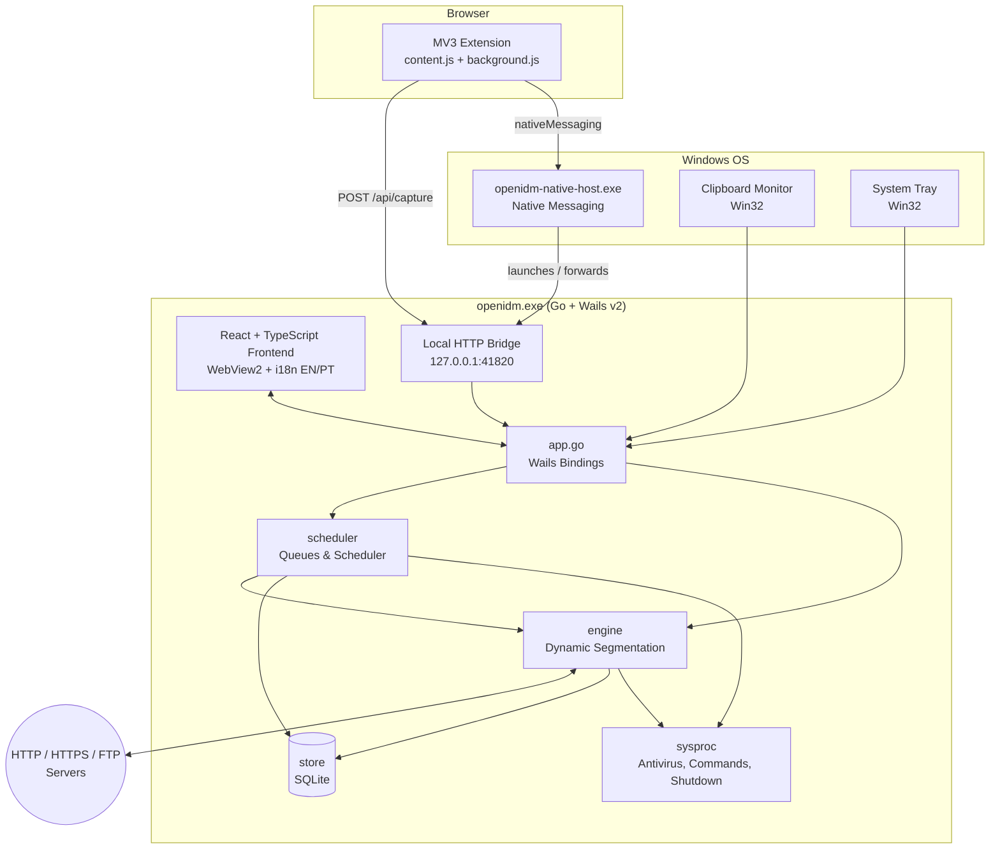

# 🏗️ Architecture

🌐 **[🇧🇷 Leia em Português](ARQUITETURA.md)** | **🇺🇸 English**

Technical overview of OpenIDM: how its packages interact and how the dynamic segmentation engine works under the hood.

---

## High-Level Overview



| Package | Responsibility |
|---|---|
| `main.go` | CLI flags, Wails window initialization, single-instance lock, tray/card startup modes |
| `app.go` | Application facade exposed to the frontend: downloads, queues, categories, settings, language, window modes, capture |
| `internal/engine` | Download engine: dynamic segment table, HTTP & FTP workers, custom transport with proxy support, speed limiter |
| `internal/scheduler` | Queues, start/stop schedules, traffic quotas, retry policies, ETag sync queue, post-queue actions |
| `internal/store` | Pure-Go SQLite persistence: downloads, segments, categories, queues, site rules, credentials, and app settings |
| `internal/integration` | Local HTTP bridge, Native Messaging, file extension classifier, clipboard monitor, Win32 system tray, installer |
| `internal/models` | Shared domain models and language normalization (`pt-BR` / `en-US`) |
| `internal/sysproc` | Safe system process execution (antivirus scanning, post-queue commands, Windows shutdown) |
| `cmd/native-host` | Browser Native Messaging Host binary (`openidm-native-host.exe`) |
| `cmd/installer` | Standalone graphical installer (`OpenIDM-Setup.exe`) |
| `frontend/` | React 18 + TypeScript + Vite UI with reactive i18n (`pt-BR` and `en-US`) |
| `browser-extension/` | Manifest V3 WebExtension for Chrome, Edge, Brave, and Firefox |

---

## Dynamic Segmentation Engine

The core of OpenIDM is `SegmentTable` (`internal/engine/segmenter.go`). Instead of statically dividing a file into *N* fixed chunks upfront, it **continuously redistributes work across connections**.

### Algorithm

```text
Download State:
  total_size        resolved via probe (HEAD / ranged GET); if unknown → single-stream mode
  segments          list of [start, current, end) with status and assigned worker ID
  workers           N concurrent connections (1..32, default 8)
  MIN_SPLIT         minimum byte size required to split a segment (default 1 MB)

Each worker loop:
  1. Acquire the LARGEST PENDING segment, if available
  2. Otherwise, find the LARGEST IN-FLIGHT segment:
       if remaining >= MIN_SPLIT → split in half (4 KB aligned)
                                    original worker's end offset is truncated to the midpoint
                                    free worker takes the second half
       else → worker exits (remaining slice is too small to split)
  3. Request the byte range reusing the SAME keep-alive TCP/TLS connection
  4. Write chunks concurrently via WriteAt into the .oidmpart file
  5. Periodically checkpoint the segment map to SQLite
  6. On transient network error → release the segment for retry / takeover
```

### Integrity & Safety Guarantees

- **Byte-Level Integrity** — `ValidateIntegrity()` verifies that completed segments cover `[0, total_size)` contiguously without gaps or overlaps before renaming `.oidmpart` to the final file.
- **Safe Degradation** — if a server omits `Accept-Ranges`, replies with `200 OK` instead of `206 Partial Content`, or exhibits range inconsistency, `DegradeToSingleConnection()` gracefully falls back to worker #1 and records `degradedReason`.
- **Crash-Proof Resume** — on startup or resume, the segment table is reconstructed from SQLite checkpoints and resumes from the exact byte offset.

---

## Multi-Language Architecture (`pt-BR` & `en-US`)

- **Backend & Storage** — `models.AppSettings` stores the `language` field (`"pt-BR"` or `"en-US"`), normalized via `models.NormalizeLanguage`.
- **Desktop UI** — `frontend/src/i18n/index.tsx` provides a strongly typed `LanguageProvider` and `useI18n()` hook covering all modals, tables, status labels, category names, and queue names.
- **System Tray & Notifications** — `internal/integration/tray_windows.go` and `app.go` dynamically translate Win32 tray tooltips, context menu items, native folder dialogs, and completion balloon notifications.
- **HTTP Bridge & Browser Extension** — `GET /api/health` exposes `"language"` so the Manifest V3 extension automatically syncs its popup UI and browser context menu with the desktop app.
