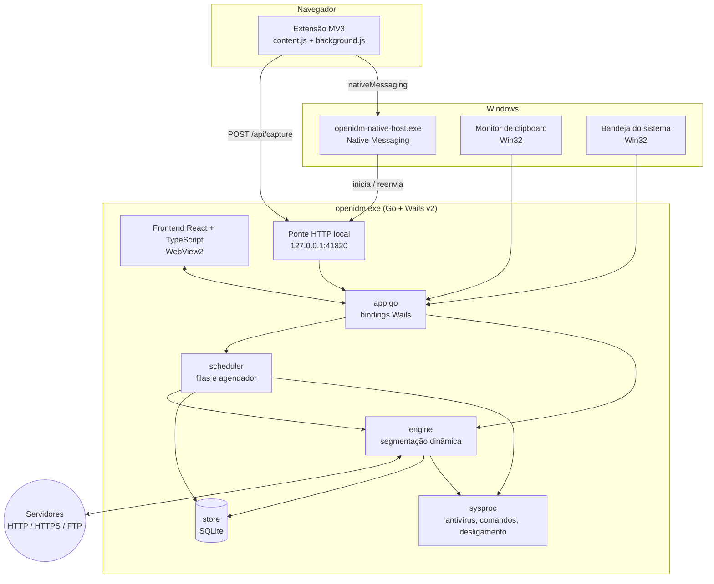

# 🏗️ Arquitetura

🌐 **🇧🇷 Português** | **[🇺🇸 Read in English](ARCHITECTURE.md)**

Visão técnica do OpenIDM: como os componentes se conectam e como o motor de segmentação dinâmica funciona.

---

## Visão geral



| Pacote | Responsabilidade |
|---|---|
| `main.go` | Flags de linha de comando, criação da janela Wails, instância única, modo bandeja/card |
| `app.go` | Fachada da aplicação exposta ao frontend: downloads, filas, categorias, configurações, janela, captura |
| `internal/engine` | Motor de download: tabela de segmentos, workers HTTP e FTP, transporte com proxy, limitador de velocidade |
| `internal/scheduler` | Filas, horários de início/parada, cota de tráfego, retries, sincronização, ações ao concluir |
| `internal/store` | Persistência SQLite: downloads, segmentos, categorias, filas, regras, credenciais e configurações |
| `internal/integration` | Ponte HTTP local, Native Messaging, classificação por extensão, clipboard, bandeja, instalador |
| `internal/models` | Tipos de domínio compartilhados entre as camadas |
| `internal/sysproc` | Execução segura de processos do sistema (antivírus, comandos pós-fila, desligamento) |
| `cmd/native-host` | Executável do Native Messaging Host |
| `cmd/installer` | Instalador gráfico `OpenIDM-Setup.exe` |
| `frontend/` | Interface React + TypeScript + Vite |
| `browser-extension/` | Extensão WebExtension Manifest V3 |

---

## Motor de segmentação dinâmica

O coração do OpenIDM é a `SegmentTable` (`internal/engine/segmenter.go`). Em vez de dividir o arquivo em N partes fixas antes de começar, ela **redistribui o trabalho continuamente**.

### Algoritmo

```text
Estado do download:
  total_size        via probe (HEAD / GET com Range); desconhecido → 1 conexão em stream
  segments          lista de [start, current, end) com status e worker responsável
  workers           N conexões (1..32, padrão 8)
  MIN_SPLIT         tamanho mínimo para dividir (padrão 1 MB)

Cada worker, em loop:
  1. pega o MAIOR segmento PENDENTE, se houver
  2. senão, pega o MAIOR segmento EM ANDAMENTO:
       se restante ≥ MIN_SPLIT → divide ao meio (alinhado a 4 KB)
                                  o worker original para no meio
                                  o worker livre assume a 2ª metade
       senão → encerra (não vale a pena dividir)
  3. baixa o range pela MESMA conexão keep-alive (sem novo handshake TLS)
  4. grava com WriteAt no arquivo .oidmpart
  5. checkpoint periódico do mapa de segmentos no SQLite
  6. erro de rede → libera o segmento para outro worker e tenta de novo
```

### Exemplo visual

```text
t0  W1 [==================================================]
t1  W1 [=========================|]  W2 [=========================]
t2  W1 [============|] W3 [======]   W2 [============|] W4 [======]
t3  todos os workers ocupados até o último byte
```

### Garantias

- **Integridade** — `ValidateIntegrity()` confere que os segmentos cobrem exatamente `[0, total_size)` sem buracos nem sobreposições antes da montagem final.
- **Degradação segura** — sem suporte a `Range`, resposta diferente de `206` ou inconsistência de dados entre conexões, a tabela chama `DegradeToSingleConnection()` e apenas o worker #1 continua. O motivo fica registrado no download (`degradedReason`).
- **Retomada** — ao reabrir o app, a tabela é reconstruída a partir dos segmentos salvos e o download continua do byte exato onde parou.

### Transporte e reuso de conexões

`internal/engine/transport.go` cria um `http.Transport` customizado com keep-alive, pool de conexões ociosas por host e suporte a proxy (sistema, HTTP/HTTPS, SOCKS5 via `golang.org/x/net/proxy` e PAC). O `httptrace` informa se cada requisição **reutilizou** uma conexão existente — essa informação aparece no log de conexões da interface.

### FTP

`internal/engine/ftp_worker.go` usa `github.com/jlaffaye/ftp` em modo **PASV**, com retomada por offset (`REST`).

### Limitador de velocidade

`internal/engine/limiter.go` implementa um **token bucket** compartilhado (limite global) combinado com limites individuais por download.

---

## Persistência

Banco SQLite em `%APPDATA%\OpenIDM\openidm.sqlite`, usando `modernc.org/sqlite` (Go puro, **sem CGO** — compilação simples, sem toolchain C).

| Tabela | Conteúdo |
|---|---|
| `downloads` | URL, nome, destino, tamanho, status, ETag/Last-Modified, limites, erros |
| `segments` | Mapa de segmentos de cada download (start, current, end, worker, status) |
| `categories` | Categorias, extensões e pasta padrão |
| `queues` | Filas e regras do agendador |
| `site_rules` | Exceções por site (curingas, máx. conexões, ignorar captura, retries) |
| `site_logins` | Credenciais por servidor |
| `app_settings` | Configurações globais |

As migrações de esquema são aplicadas automaticamente na inicialização e cobertas por testes (incluindo cenários adversariais de migração de pastas antigas).

> As credenciais de sites e proxy ficam armazenadas localmente no banco SQLite do usuário. Proteja o acesso ao seu perfil do Windows.

---

## Integração com o sistema

### Ponte HTTP local

`internal/integration/http_bridge.go` expõe uma API REST em **`127.0.0.1:41820`** (apenas loopback), usada pela extensão e pelo Native Host:

| Endpoint | Uso |
|---|---|
| `GET /api/health` | Verificação de disponibilidade |
| `GET /api/events` | Eventos em tempo real (Server-Sent Events) |
| `POST /api/capture` | Recebe um link capturado pelo navegador |
| `/api/downloads`, `/api/downloads/action` | Listagem e ações sobre downloads |
| `/api/queues`, `/api/queues/action` | Filas |
| `/api/categories`, `/api/settings`, `/api/site-rules`, `/api/site-logins` | Configuração |
| `/api/classify` | Classificação de URL por categoria |
| `/api/installer/*` | Status e execução do instalador |

### Native Messaging

`openidm-native-host.exe` implementa o protocolo oficial (mensagens com prefixo `uint32` little-endian + JSON via stdin/stdout). Ele é registrado em:

```text
HKCU\Software\Google\Chrome\NativeMessagingHosts\com.rafatech.openidm
HKCU\Software\Microsoft\Edge\NativeMessagingHosts\com.rafatech.openidm
HKCU\Software\Mozilla\NativeMessagingHosts\com.rafatech.openidm
```

Se o app estiver fechado, o host inicia `openidm.exe --tray` e reenvia o link pela ponte local.

### Bandeja, clipboard e janela

- **Bandeja** e **monitor de clipboard** são implementados direto sobre a **Win32 API** (`user32`), sem subprocessos nem bibliotecas extras.
- **Instância única** via Wails `SingleInstanceLock`: um segundo `openidm.exe <url>` entrega a URL à instância já aberta.
- **Modos de janela**: app completo, Card Solto (posição persistida) e oculto na bandeja.

### Instalador

`cmd/installer` gera o `OpenIDM-Setup.exe`, uma interface gráfica que executa `integration.RunInstallation`:

1. Copia `openidm.exe`, `openidm-native-host.exe`, o instalador e a pasta `browser-extension` para `%LOCALAPPDATA%\Programs\OpenIDM`;
2. Registra o Native Messaging Host;
3. Configura a inicialização com o Windows (na bandeja);
4. Cria atalhos na Área de Trabalho e no Menu Iniciar;
5. Registra o desinstalador em `HKCU\...\Uninstall\OpenIDM`;
6. Opcionalmente abre o assistente de ativação da extensão.

A instalação é **por usuário** e não exige privilégios de administrador.

---

## Decisões técnicas

| Decisão | Motivo |
|---|---|
| **Go** para o motor | Concorrência simples com goroutines e controle fino do `net/http` |
| **Wails v2** em vez de Electron | Binário pequeno, usa o WebView2 do sistema, todo o core em Go |
| **SQLite sem CGO** | Build trivial em Windows, banco portátil e transacional |
| **Ponte HTTP + Native Messaging** | Ponte é rápida quando o app está aberto; Native Messaging garante que o app seja iniciado quando fechado |
| **Win32 direto** para bandeja/clipboard | Menos dependências e menor consumo de recursos |
| **Sem driver de kernel** | Captura via extensão cobre a maioria dos casos sem os riscos e a assinatura exigidos por um driver WFP |
