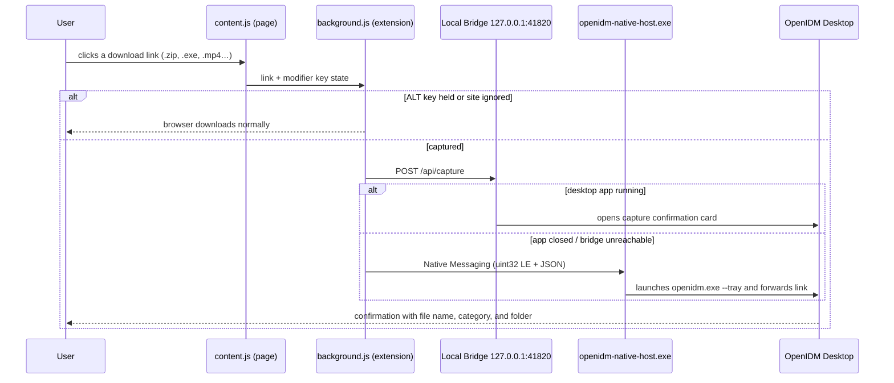

# 🌐 Browser Extension Guide

🌐 **[🇧🇷 Leia em Português](EXTENSAO-NAVEGADOR.md)** | **🇺🇸 English**

The **OpenIDM — Advanced Download Capture** extension integrates Google Chrome, Microsoft Edge, Brave, and Mozilla Firefox with OpenIDM. It intercepts downloads of monitored file types and hands the link off to the desktop app for multi-segment acceleration and organization.

---

## How It Works



1. The **content script** monitors link clicks and records whether a bypass modifier key (`ALT`, `CTRL`, or `SHIFT`) was held.
2. The **service worker** checks whether the download should be intercepted (capture enabled, matching file extension or binary stream, host not ignored).
3. The link is sent first to the **local HTTP bridge** (`127.0.0.1:41820`), which only accepts loopback connections on your machine.
4. If the desktop app is closed, the extension falls back to the **Native Messaging Host**, which launches OpenIDM in the system tray and delivers the link.
5. OpenIDM displays the confirmation dialog in the Compact Card.

---

## Installation

### Automatic Setup (Recommended)

The OpenIDM installer (`OpenIDM-Setup-1.0.0-x64.exe`) automatically:

- Copies the extension to `%LOCALAPPDATA%\Programs\OpenIDM\browser-extension`;
- Registers the Native Messaging Host `com.rafatech.openidm` in the Windows Registry (`HKCU`) for Chrome, Edge, Brave, and Firefox;
- Opens an interactive **bilingual setup guide (EN / PT)** and copies the extension folder path to your clipboard (`Ctrl+V`).

You can also open this guide anytime from the toolbar via **Installer & Extension**.

### Chrome / Edge / Brave (Manual)

1. Open `chrome://extensions` (Chrome) or `edge://extensions` (Edge).
2. Enable **Developer mode** (top-right toggle).
3. Click **Load unpacked** and select the `browser-extension` folder (or drag and drop the folder onto the page).
4. Register the Native Host if needed:

   ```powershell
   openidm-native-host.exe --install --ext-id <EXTENSION_ID>
   ```

### Firefox (Manual)

1. Open `about:debugging#/runtime/this-firefox`.
2. Click **Load Temporary Add-on…** and select `browser-extension/manifest.json`.
3. The extension uses the ID `openidm@rafatech.local` (Firefox 109+).

---

## Usage & Language Switching

| Action | Result |
|---|---|
| Click a monitored file link | OpenIDM captures the download and shows the confirmation card |
| **`ALT` + click** | Browser downloads the file normally without OpenIDM interception |
| Right-click → **Download with OpenIDM** | Sends any link, image, audio, or video URL to OpenIDM |
| Extension popup → **Intercept download links** | Enables or disables automatic capture |
| Extension popup → **Open OpenIDM Window** | Brings the desktop application to the foreground |
| Extension popup → **`EN` / `PT` badge** | Switches the extension popup and context menu between English and Portuguese |

The extension popup automatically synchronizes its language with the OpenIDM Desktop app via `/api/health`, and also allows manual switching via the language button in the popup header.

---

## Permissions Explained

| Permission | Reason |
|---|---|
| `downloads` | Intercept downloads started by the browser |
| `nativeMessaging` | Communicate with `openidm-native-host.exe` when the app is closed |
| `contextMenus` | Add "Download with OpenIDM" to the right-click menu |
| `storage` | Store capture and language preferences locally |
| `tabs`, `scripting` | Inject the click listener into open tabs |
| `<all_urls>` | Detect download links across websites |
| `http://127.0.0.1:41820/*` | Communicate with the local OpenIDM Desktop bridge |

The extension **collects zero telemetry** and never communicates with external servers — all communication stays strictly on `127.0.0.1` between your browser and OpenIDM on your computer.
