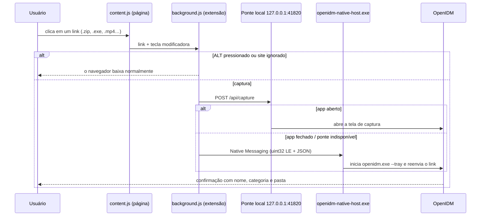

# 🌐 Extensão do navegador

🌐 **🇧🇷 Português** | **[🇺🇸 Read in English](BROWSER-EXTENSION.md)**

A extensão **OpenIDM — Captura Avançada de Downloads** integra Chrome, Edge e Firefox ao OpenIDM (com suporte a Português e Inglês). Ela intercepta os downloads de tipos monitorados e entrega o link ao aplicativo, que cuida da organização e da aceleração.

---

## Como funciona



1. O **content script** observa os cliques em links e registra se uma tecla modificadora estava pressionada.
2. O **service worker** decide se o download deve ser capturado (extensão monitorada, captura ligada, site não ignorado).
3. O link é enviado primeiro para a **ponte HTTP local** (`127.0.0.1:41820`), que só aceita conexões da própria máquina — é o caminho mais rápido.
4. Se o app estiver fechado, a extensão usa o **Native Messaging Host**, que inicia o OpenIDM em segundo plano e entrega o link.
5. O OpenIDM exibe a confirmação (no Card Solto quando está em segundo plano).

---

## Instalação

### Automática (recomendada)

O instalador do OpenIDM (`OpenIDM-Setup.exe`) já:

- copia a extensão para a pasta de instalação;
- registra o Native Messaging Host `com.rafatech.openidm` no Registro do Windows (`HKCU`) para Chrome, Edge e Firefox;
- abre um **assistente visual** de ativação da extensão.

Você também pode abrir o assistente a qualquer momento em **Instalador & Extensão** na barra de ferramentas.

### Chrome / Edge (manual)

1. Acesse `chrome://extensions` (Chrome) ou `edge://extensions` (Edge).
2. Ative o **Modo do desenvolvedor**.
3. Clique em **Carregar sem compactação** e selecione a pasta `browser-extension` (ou arraste a pasta para a página).
4. Registre o Native Host, se ainda não tiver feito:

   ```powershell
   openidm-native-host.exe --install --ext-id <ID_DA_EXTENSÃO>
   ```

   O ID aparece no cartão da extensão em `chrome://extensions`.

### Firefox (manual)

1. Acesse `about:debugging#/runtime/this-firefox`.
2. Clique em **Carregar extensão temporária…** e selecione `browser-extension/manifest.json`.
3. A extensão usa o ID `openidm@rafatech.local` (Firefox 109 ou superior).

> Extensões temporárias do Firefox são removidas ao fechar o navegador. Para uso permanente, a extensão precisa ser assinada pela Mozilla (planejado).

---

## Uso

| Ação | Resultado |
|---|---|
| Clicar em um link de arquivo monitorado | O OpenIDM captura e mostra a confirmação |
| **`ALT` + clique** | O navegador baixa normalmente, sem captura |
| Botão direito → **Baixar com o OpenIDM** | Envia o link (também funciona em vídeo e áudio) |
| Ícone da extensão → **Interceptar links de download** | Liga/desliga a captura automática |
| Ícone da extensão → **Abrir Janela do OpenIDM** | Traz o app para frente |

O popup também mostra se o **OpenIDM Desktop** está conectado.

### Personalizando o que é capturado

Em **Opções** no OpenIDM:

- **Extensões capturadas** — lista dos tipos interceptados automaticamente;
- **Tecla modificadora** para ignorar a captura (padrão `ALT`);
- **Exceções por site** — marque *Ignorar captura* para domínios como `*.exemplo.com`.

---

## Permissões solicitadas

| Permissão | Por quê |
|---|---|
| `downloads` | Interceptar downloads iniciados pelo navegador |
| `nativeMessaging` | Comunicar-se com o `openidm-native-host.exe` |
| `contextMenus` | Item "Baixar com o OpenIDM" no menu de contexto |
| `storage` | Guardar a preferência de captura ligada/desligada |
| `tabs`, `scripting` | Injetar o detector de cliques nas abas já abertas |
| `<all_urls>` | Detectar links de download em qualquer site |
| `http://127.0.0.1:41820/*` | Falar com a ponte local do OpenIDM |

A extensão **não coleta dados** e não se comunica com nenhum servidor externo — todo o tráfego fica entre o navegador e o OpenIDM na sua própria máquina.

---

## Solução de problemas

| Problema | O que verificar |
|---|---|
| Popup mostra o OpenIDM desconectado | Abra o OpenIDM (ou verifique se ele está na bandeja) |
| Downloads não são capturados | Captura ligada no popup? A extensão do arquivo está na lista? O site não está nas exceções? |
| App não abre quando está fechado | Reinstale o Native Host: `openidm-native-host.exe --install --ext-id <ID>` |
| Captura em sites que não deveria | Adicione o domínio em **Exceções por site → Ignorar captura** |
