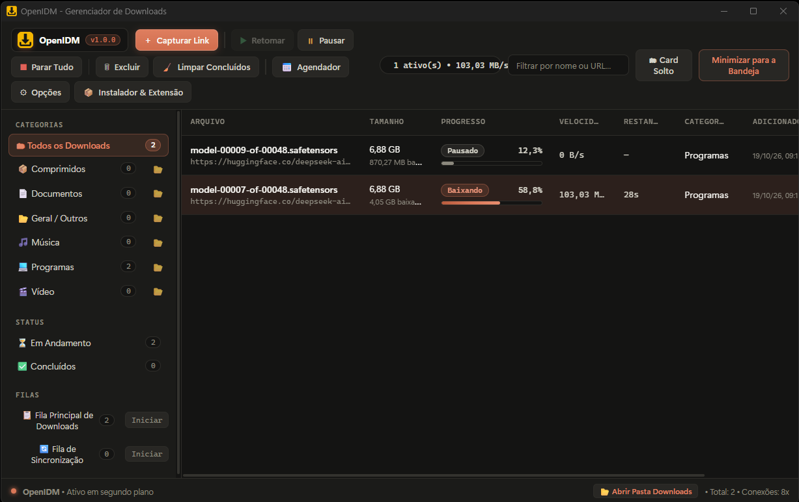
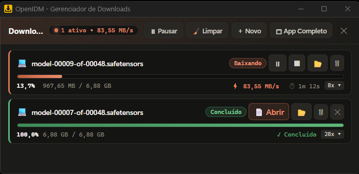

# 📘 User Guide

🌐 **[🇧🇷 Leia em Português](GUIA-DE-USO.md)** | **🇺🇸 English**

This guide covers the OpenIDM interface and everyday workflows.

- [Switching Languages (English / Portuguese)](#switching-languages-english--portuguese)
- [Main Window](#main-window)
- [Adding Downloads](#adding-downloads)
- [Monitoring a Download](#monitoring-a-download)
- [Compact Card (Standalone Card)](#compact-card-standalone-card)
- [System Tray](#system-tray)
- [Categories](#categories)
- [Queues & Scheduler](#queues--scheduler)
- [Options](#options)
- [Shortcuts & Tips](#shortcuts--tips)

---

## Switching Languages (English / Portuguese)

OpenIDM supports **English (`en-US`)** and **Brazilian Portuguese (`pt-BR`)** natively across all screens:

1. **Quick Toggle on the Toolbar** — click the **`🌐 EN`** / **`🌐 PT`** button in the top-right corner of the main window to switch languages immediately.
2. **Options Modal** — open **Options → Connections & Site Rules** and select your preferred **Interface Language** (`🇺🇸 English (United States)` or `🇧🇷 Português (Brasil)`).
3. **Browser Extension & Installer** — both the browser extension popup and the standalone installer (`OpenIDM-Setup.exe`) automatically detect your language or let you toggle between `PT` and `EN` in the header.

Your language preference is saved in SQLite (`%APPDATA%\OpenIDM\openidm.sqlite`) and automatically synchronizes the desktop UI, Compact Card, Windows system tray menu, native notifications, and browser extension.

---

## Main Window

| Area | Purpose |
|---|---|
| **Toolbar** | Capture Link, Resume, Pause, Stop All, Delete, Clear Completed, Scheduler, Options, and Installer & Extension |
| **Activity Indicator** | Number of active downloads and real-time aggregate transfer speed |
| **Search Filter** | Instant filtering by file name or URL |
| **Compact Card / Minimize to Tray** | Switches to the compact floating card or hides the main window while downloads continue in the background |
| **Language Switcher (`🌐 EN / PT`)** | Instantly toggles between English (`en-US`) and Portuguese (`pt-BR`) |
| **Sidebar — Categories** | Filters the list by category; click the folder icon to open that category's directory in Windows Explorer |
| **Sidebar — Status** | Filter by In Progress or Completed |
| **Sidebar — Queues** | Main Queue, Sync Queue, and custom queues with a quick **Start / Active** toggle |
| **Download Table** | File name, size, progress bar, speed, remaining time, category, and date added |
| **Status Bar** | Quick button to open the Downloads folder, total item count, and default connection multiplier |

---

## Adding Downloads

There are several ways to send a link to OpenIDM:

1. **Capture Link** — click the orange button on the toolbar and paste the URL. If a valid URL is already on your clipboard, it is pre-filled automatically.
2. **Browser Integration** — with the [browser extension](BROWSER-EXTENSION.md) installed, downloads matching monitored extensions are intercepted automatically.
3. **Context Menu** — right-click any link or media element in your browser → **Download with OpenIDM**.
4. **Clipboard Monitor** — when enabled, copying a file URL prompts OpenIDM to capture it.
5. **Command Line** — `openidm.exe "https://example.com/file.zip"`.
6. **System Tray** — right-click the tray icon → **New Download (Save Link)...**

In the confirmation dialog, OpenIDM probes the server and displays:

- **File Name** (editable);
- **Category** automatically classified by file extension and its corresponding **Save Folder**;
- **Total Size** and whether the server supports multi-segment downloads (*Accept-Ranges*).

You can change the category, pick a custom destination folder, and either click **Download Now** or **Download Later** (adds to queue).

---

## Monitoring a Download

Double-click any download row (or click the `ℹ` icon) to open **Download Details**:

- **Segment Bar** — visualizes every byte slice of the file and which connection worker is downloading it;
- **Downloaded, Speed, and Remaining Time** updated in real time;
- **Active Connections Table** — per-connection downloaded bytes, speed, and status;
- **Speed Limit** — apply an individual bandwidth limit to that specific download.

### Download Statuses

| Status | Meaning |
|---|---|
| **Queued** | Waiting for a slot in the queue or for the scheduled start time |
| **Connecting...** | Probing the server (file size, `Range` support, `ETag`) |
| **Downloading** | Actively transferring data |
| **Paused** | Paused by the user; can be resumed anytime without losing progress |
| **Assembling...** | Verifying segment integrity and finalizing the `.oidmpart` file |
| **Completed** | Final file is ready in the destination folder |
| **Stopped** | Cancelled by the user |
| **Error** | Failed after configured retries — click **Resume** to try again |

> If a server does not support byte-range requests, OpenIDM automatically degrades to **1 connection** and displays the reason.

---

## Compact Card (Standalone Card)

The **Compact Card** is a streamlined floating window designed to stay out of your way while you work:

- Shows progress bar, percentage, file size, transfer speed, and ETA for each active download;
- Quick buttons to **Pause**, **Stop**, **Open Folder**, **Open File**, or **Delete**;
- Expandable **Segment Bar** per item;
- Top controls for **Pause All**, **Clear Completed**, **+ New**, and **Full App** to switch back to the main window.

The card's screen position is persisted across restarts. When a link is captured from the browser while OpenIDM is in the background, the confirmation prompt opens directly in the Compact Card.

---

## System Tray

Closing the main window **does not quit** OpenIDM: it stays active in the Windows system tray (near the clock) and displays native notifications when downloads complete.

Right-click tray menu options:

- 🚀 Open OpenIDM (Full App)
- 🗂 Open Compact Card
- ➕ New Download (Save Link)...
- ⚡ Start Main Queue
- ⏸ Pause All Downloads
- ❌ Exit OpenIDM

---

## Categories

Every download is automatically classified by its file extension and routed to the category's default folder:

| Category | Default Extensions |
|---|---|
| 📦 Compressed | zip, rar, 7z, tar, gz, bz2, xz, tgz, zst, torrent |
| 📄 Documents | pdf, doc, docx, xls, xlsx, ppt, pptx, txt, csv, epub, md |
| 🎵 Music | mp3, wav, flac, aac, ogg, m4a, wma, opus |
| 💻 Programs | exe, msi, iso, img, apk, dmg, deb, rpm, bat, ps1, safetensors, gguf, ckpt, pt, pth, onnx, bin, whl |
| 🎬 Video | mp4, mkv, webm, avi, mov, flv, wmv, m4v, ts |
| 📁 General / Others | any other file extension |

> AI model weights (`.safetensors`, `.gguf`, `.onnx`, etc.) are recognized out of the box — ideal for downloading large models from Hugging Face.

---

## Queues & Scheduler

Click **Scheduler** on the toolbar to manage queues:

| Setting | Description |
|---|---|
| **Concurrent downloads** | How many items in the queue download simultaneously |
| **Scheduled Start Time (HH:MM)** | Automatically starts the queue at this time (blank = manual start) |
| **Automatic Stop Time (HH:MM)** | Pauses all items in the queue at this time |
| **Traffic Quota / Limit (MB)** | Stops the queue once the specified data volume is reached |
| **Retry Interval (seconds)** | Delay before retrying a failed download (default 30 s) |
| **Max Retries** | `0` = infinite retries |
| **Run Command on Finish** | Program or script executed when the queue finishes |
| **Shut Down Computer** | Automatically shuts down Windows when all downloads in the queue finish (can be aborted) |
| **Sync Queue (ETag)** | Periodically checks `ETag` / `Last-Modified` headers on the server and re-downloads updated files |

---

## Options

Click **Options** on the toolbar to configure advanced settings:

### Connections & Site Rules
- Interface Language (`English (en-US)` or `Português (pt-BR)`);
- Default max connections per download (1 to 32, default 8);
- Minimum split size (`MIN_SPLIT KB`, default 1024 KB);
- Global speed limit (KB/s, `0` = unlimited);
- Per-site rules with wildcards (`*.example.com`) to customize max connections or bypass browser capture.

### Capture & Browsers
- Launch OpenIDM automatically with Windows (hidden in system tray);
- Monitor Clipboard for download URLs;
- Modifier key to bypass capture in the browser (default `ALT`);
- List of file extensions captured automatically;
- Native Messaging Host registration and quick access to the Official Installer.

### Site Logins
Automatic per-server credentials (`HTTP Basic`, `Bearer Token`, or `FTP`) matched by host pattern.

### Proxy / SOCKS5
Direct connection, System Proxy, manual HTTP/HTTPS proxy, SOCKS5 proxy, or PAC auto-configuration script with optional authentication.

### Folders & Antivirus
- Default general downloads folder;
- SQLite checkpoint interval (seconds);
- Automatic antivirus scan upon download completion (use `[file]` as the file path placeholder).

---

## Shortcuts & Tips

- Hold **`ALT`** while clicking a link in your browser to let the browser download it normally.
- Press **`Ctrl+V`** anywhere in the main window to paste and capture a URL from your clipboard.
- Use **Clear Completed** to keep your download list tidy without deleting files from disk.
- If a server blocks too many concurrent connections, add a **Site Rule** limiting that host to 2–4 connections.
